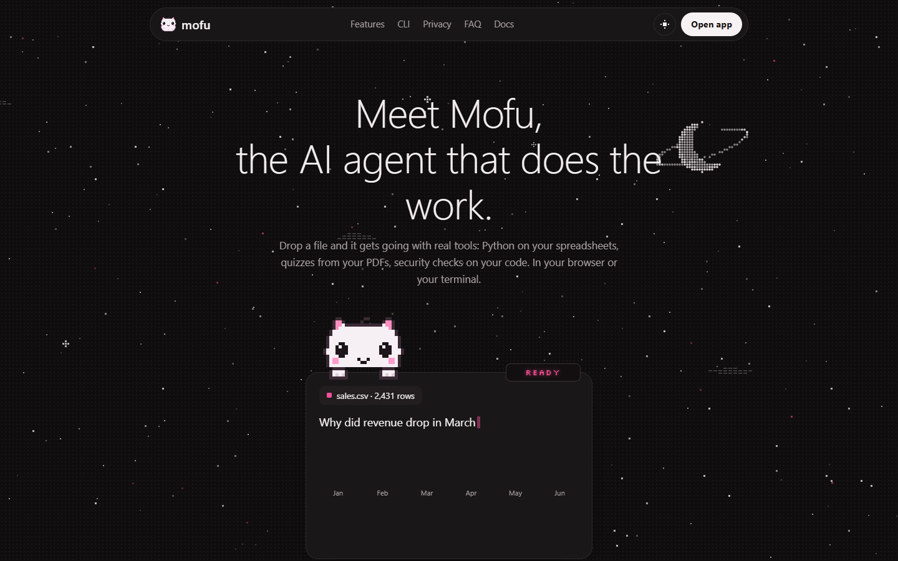
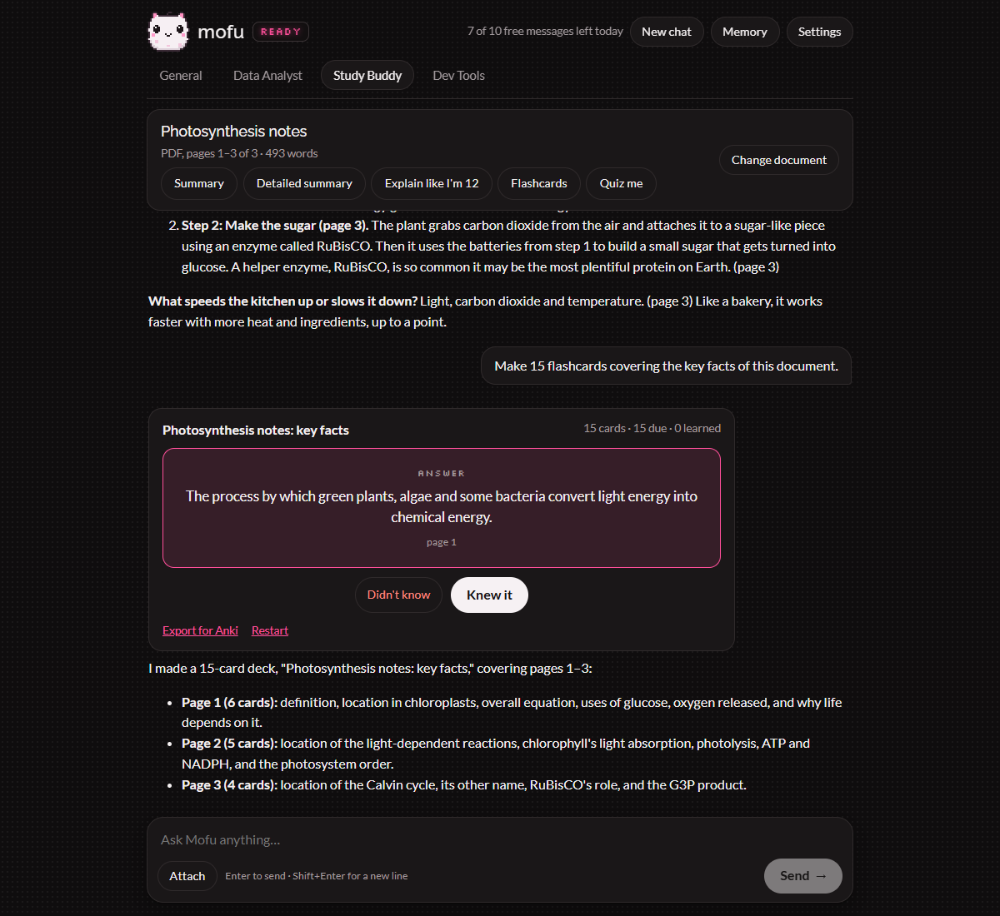
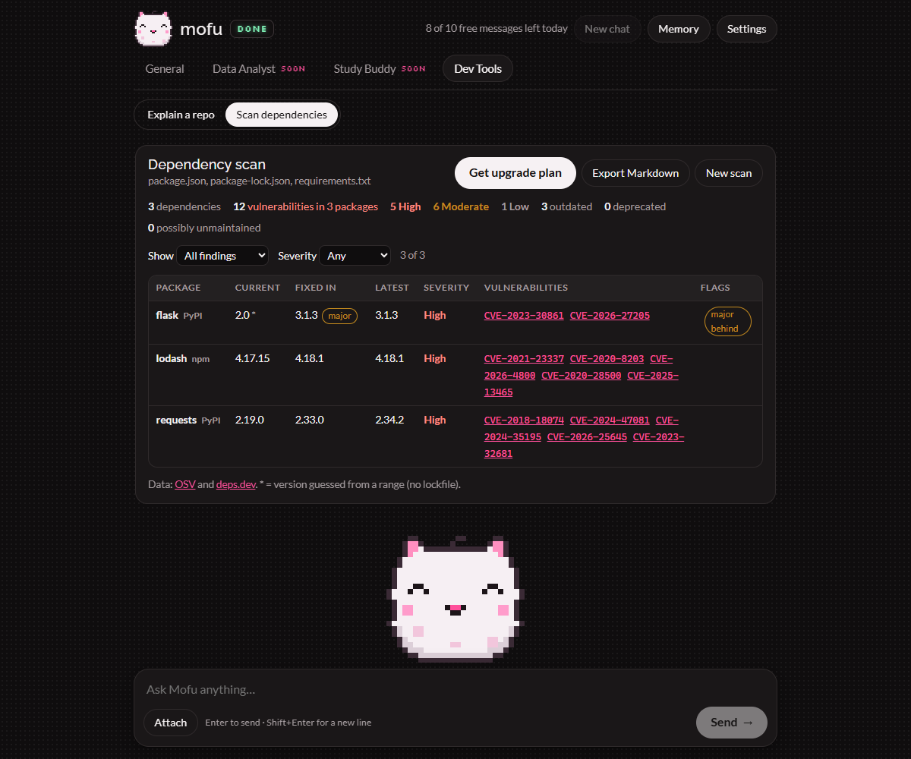
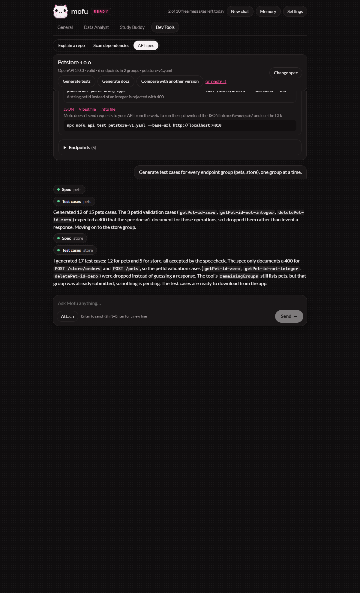

# Mofu

**The AI agent that does the work.** Drop a spreadsheet, a PDF, a project or an API spec, and Mofu works on it with real tools: Python for the numbers, page-cited study notes and quizzes, vulnerability databases for your dependencies, and your own tests for code changes.

Use it free at **[mofu.works](https://mofu.works)** (no account), or in your terminal with `npx mofu-cli` ([npm](https://www.npmjs.com/package/mofu-cli)). News and updates on X: [@mofu_works](https://x.com/mofu_works).



| Study Buddy                                            | Dependency scan                                            | API test cases                                 |
| ------------------------------------------------------ | ---------------------------------------------------------- | ---------------------------------------------- |
|  |  |  |

## What it does

- **Data Analyst:** CSV, Excel and JSON files analyzed with Python (pandas) in a sandbox, with charts and reports, plus exchange rates, holidays, weather and World Bank data.
- **Study Buddy:** summaries at three levels, flashcards with spaced repetition and Anki export, and quizzes, all citing the page.
- **Dev Tools:** explain a GitHub repository, find vulnerable or deprecated dependencies, generate tests, docs and breaking-change reports from an OpenAPI spec.
- **In the terminal:** coding tasks on a branch with your tests, `mofu fix` for failing builds, commit messages and pull requests written for you, AI code review of a branch or PR, dependency upgrades, API test runs. It asks before every change.
- **For builders:** `mofu secrets` (keys and seed phrases in files and git history), `mofu audit` (Solidity before you deploy) and a [GitHub Action](action.yml) that runs them with the dependency check on every PR.
- **Robinhood Chain safety:** the Token Scanner (what a contract allows, a simulated sell, copycats), Wallet Health with one-click revoke, and a transaction explainer, in the web app, in the CLI (`mofu scan`, `mofu wallet`), over MCP and as a JSON API with webhooks.
- **For trading agents:** [mofu-sdk](packages/sdk) on npm, and [examples/safe-trading-agent](examples/safe-trading-agent), which asks Mofu before every buy and refuses what it flags.

## Quick start

**Web:** open the app, pick a mode, drop a file. 10 free messages a day, or add your own [OpenRouter](https://openrouter.ai) key in Settings.

**CLI** (Node.js 22.13+, and an OpenRouter key or a local model with `--local`):

```sh
npx mofu-cli auth                 # save your key once
npx mofu-cli                      # chat in the current folder
npx mofu-cli task "add a --verbose flag"
npx mofu-cli study notes.pdf
npx mofu-cli deps
npx mofu-cli scan 0xTOKEN         # no key needed for chain checks
```

Full documentation: the `/docs/` page of the web app ([source](apps/web/docs/index.html)) and the [CLI README](apps/cli/README.md).

## Repository layout

```
packages/core   Agent loop, tools, prompts, and the data, study, dependency and API modules
packages/sdk    mofu-sdk: the public API client for agents and bots (published to npm)
apps/cli        The `mofu` command (published to npm, bundled with esbuild)
apps/web        Cloudflare Worker (Hono API) + landing page, docs and React app
apps/guard      Mofu Guard browser extension
examples/       The safe trading agent template
contracts/      MofuVerdicts: the on-chain verdict registry (Foundry)
assets/         Screenshots
apps/web/privacy, apps/web/terms   Privacy policy and terms pages (mofu.works/privacy/, /terms/)
mascot/         The approved mascot concept
prompts/        The build brief and per-phase prompts
```

## Development

Requires Node.js 22.13+ and pnpm.

```sh
pnpm install
pnpm mofu            # run the CLI from source
pnpm dev:web         # web app at http://localhost:5173 (copy apps/web/.dev.vars.example to .dev.vars first)
pnpm test            # unit tests (no network, no model calls)
pnpm typecheck
pnpm lint
pnpm build
```

Set `OPENROUTER_API_KEY` (or run `pnpm mofu auth`) before chatting.

**Live smoke test** (one real, billed model call with the cheap default model):

```powershell
$env:MOFU_LIVE_TEST = "1"; pnpm test
```

**Adding a tool**

1. Create `packages/core/src/tools/<name>.ts` with `defineTool({ name, description, inputSchema, kind, surfaces, execute })`. Write and exec tools also need `describeApproval`, which builds what the user sees before approving.
2. Add it to `ALL_TOOLS` in `packages/core/src/tools/all.ts`.
3. Add tests under `packages/core/test/` with mocked network calls.

## Self-hosting

The web app is one Cloudflare Worker with a Durable Object (free plan works). You need an OpenRouter key and a Turnstile widget. [LAUNCH.md](LAUNCH.md) walks through the setup, secrets, deploy, custom domain and the recovery playbook; [AUDIT.md](AUDIT.md) has the security, cost and licensing review.

## Data sources

Wikipedia (CC BY-SA 4.0), Free Dictionary API, Datamuse, arXiv, Crossref, Open Library, Frankfurter (ECB rates), Nager.Date, Open-Meteo (CC BY 4.0, non-commercial), World Bank, OSV, deps.dev and GitHub. Models via OpenRouter. Thank you to arXiv for use of its open access interoperability. Mofu isn't affiliated with any of them.

## License

[MIT](LICENSE)
